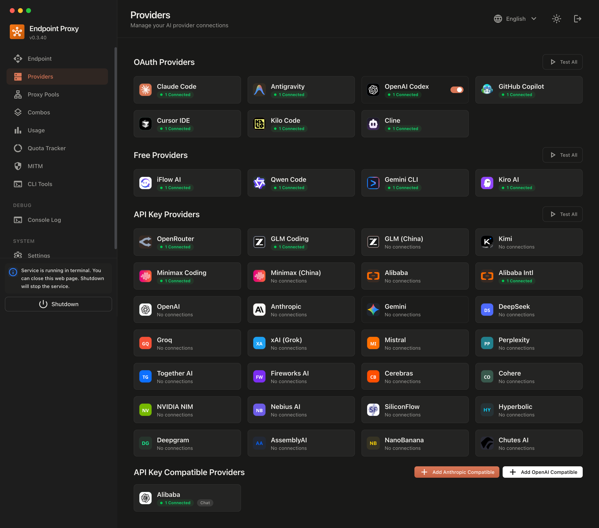

<div align="center">



# 9Router AegisX

**自托管的 AI 编程助手网关 —— 一个端点、40+ 提供商、100+ 模型，外加可节省 20–40% prompt 开销的 Token Saver 管线。**

[](https://github.com/FerzDevZ/9router-aegisx/actions/workflows/ci.yml)
[](./LICENSE)
[](https://github.com/decolua/9router)

由 [FirzDevZ](https://github.com/FerzDevZ) 独立维护的 [9router](https://github.com/decolua/9router) 加固分支 —— 完整保留上游功能，并叠加安全加固、精准的 token 计费、CI 全绿的 4,100+ 单测套件与全面刷新的文档。差异详见 [CHANGELOG](./CHANGELOG.md)。

[文档](#文档) · [快速开始](#快速开始) · [架构](./docs/ARCHITECTURE.md) · [更新日志](./CHANGELOG.md)

</div>

---

## 它做什么

9Router AegisX 部署在你的 AI 编程工具与提供商之间：

- **一个兼容 OpenAI / Anthropic / Gemini 的统一端点**：Claude Code、Codex CLI、Cursor、Cline、Roo、Continue、Gemini CLI、OpenCode、OpenClaw、Crush、Droid、Kilo 等工具全部指向 `http://localhost:20128/v1`，以 `提供商/模型` ID 路由。
- **带回退策略的组合（Combos）**：按 订阅 → 低价 → 免费 分层编排（顺序回退、轮询、带 prompt-cache 会话策略的 System One 智能路由，或并行融合 + Judge 模型）。
- **Token Saver**：RTK 输出过滤器、工具结果去重、History GC、响应缓存、Headroom / Caveman / Ponytail / Pxpipe 集成，并配备实时节省记分板。
- **用量分析**：按提供商/模型/密钥的 token 与成本追踪、缓存命中率、请求详情、配额追踪与重置自动 ping。
- **完全自控**：凭据保存在本地 SQLite；仪表盘认证（密码或 OIDC/SAML SSO）、按密钥的访问控制、限流、安全响应头，以及 serverless 代理池的按部署共享密钥。

## 工作原理

```
Claude Code ─┐                              ┌─ Anthropic / Claude OAuth
Cursor ──────┤   /v1 (OpenAI, Responses,    ├─ OpenAI / Codex / GitHub Copilot
Codex CLI ───┼─▶ Anthropic, Gemini 格式) ───┼─ Gemini / Vertex / Antigravity
任意客户端 ───┤      9Router AegisX 网关     ├─ 40+ 提供商执行器
             └──────────────────────────────┴─ (OAuth、API key、免费层)
                     │
                     ├─ 翻译层（请求/响应，4 种线上格式）
                     ├─ 组合引擎（回退 · 轮询 · 智能路由 · 融合）
                     ├─ Token Saver（RTK · 去重 · History GC · 缓存）
                     └─ SQLite 用量存储 + 仪表盘（localhost:20128）
```

完整组件图谱见 [docs/ARCHITECTURE.md](./docs/ARCHITECTURE.md)。

## 快速开始

环境要求：Node.js ≥ 22（Docker 镜像固定 22.23.4）。

```bash
git clone https://github.com/FerzDevZ/9router-aegisx.git
cd 9router-aegisx
npm install
npm run build
npm start -- --port 20128    # 服务运行于 http://localhost:20128
```

> npm 脚本默认使用端口 **20127**；Docker 与本文所有示例统一使用 **20128** —— 按上面所示追加 `-- --port 20128`（或自行指定）。

**Docker（源码构建）：**

```bash
git clone https://github.com/FerzDevZ/9router-aegisx.git
cd 9router-aegisx
docker build -t 9router-aegisx .
docker run -d --name 9router -p 20128:20128 \
  -v "$HOME/.9router:/app/data" -e DATA_DIR=/app/data 9router-aegisx
```

上游仓库的预构建镜像（Docker Hub / GHCR 上的 `decolua/9router`）同样可以运行本代码库。compose、健康检查与升级说明见 [DOCKER.md](./DOCKER.md)。

**首次登录** —— 首次运行会生成随机的一次性仪表盘密码并打印在服务器控制台（保存在 `DATA_DIR/initial-password`，设置正式密码后删除）。设置 `INITIAL_PASSWORD` 可自行指定。

## 接入你的工具

把任意 OpenAI 兼容客户端指向网关，并用 `提供商/` 前缀选择模型：

```bash
curl http://localhost:20128/v1/chat/completions \
  -H "Content-Type: application/json" \
  -H "Authorization: Bearer $KEY" \
  -d '{"model":"cc/claude-sonnet","messages":[{"role":"user","content":"hi"}]}'
```

| 线上格式 | 端点 | 适用工具 |
|---|---|---|
| OpenAI Chat | `/v1/chat/completions` | Cursor、Cline 及大多数工具 |
| OpenAI Responses | `/v1/responses` | Codex CLI |
| Anthropic Messages | `/v1/messages` | Claude Code |
| Gemini | `/v1beta/models/...` | Gemini CLI、Antigravity |

同时提供：`/v1/models`、`/v1/embeddings`、`/v1/images/generations`、`/v1/audio/transcriptions` 与 `/v1/audio/speech`（语音转文字 / 文字转语音），以及 `/api/mcp` 下的 MCP 服务器。

仪表盘的 **CLI Tools** 页面可自动把正确的 base URL 和模型 ID 写入各工具配置（也可使用 `cli/` 的 `connect` 命令）。常用提供商前缀：`cc/` Claude、`cx/` Codex、`gc/` Gemini CLI、`glm/`、`if/` iFlow、`kr/` Kiro、`oc/` OpenCode、`tr/` Trae、`ws/` Windsurf —— 完整实时列表见 `/v1/models` 与仪表盘模型选择器。

## 组合（Combos）

一个组合就是一个由有序成员与策略支撑的模型 ID：

1. **Fallback（回退）** —— 按顺序尝试成员；遇到 429/5xx、瞬时错误以及请求级 4xx 时前进到下一个。
2. **Round Robin（轮询）** —— 在请求间轮转成员（可配置粘性上限）。
3. **Smart Router（System One）** —— 由决策模型按 prompt 选择最优成员；会话策略保持提供商 prompt cache 温热（≥80% 置信度的 Smart Switch、零延迟全量复用的 Strict Lock，或逐轮评估的 Per-Turn）。
4. **Fusion（融合）** —— 并行查询全部成员，由 Judge 模型综合出最终答案（质量最高，按 N+1 计费）。

## Token Saver

在请求体发送前应用；每个 saver 可单独开关，仪表盘记分板（`Usage → Token Saver Scoreboard`，`GET /api/usage/savers`）实时统计命中与节省字节数。

| Saver | 效果 | 默认 |
|---|---|---|
| RTK 过滤器 | 对 `git diff`、`grep`、`ls`、`tree`、日志等做类型感知的无损压缩 | 开 |
| 工具结果去重 | 字节级相同的重复工具输出 → 一行引用 | 开 |
| test-runner 过滤器 | 保留失败 + 摘要，略过通过墙（vitest/jest/pytest/go/mocha/TAP） | 自动 |
| History GC | 将早于最近 N 个用户轮次的工具结果压成摘要 | 关（`historyGcEnabled`，N=6） |
| 响应缓存 | 非流式对话的精确请求缓存（LRU+TTL，命中带 `x-9r-cache: hit`） | 关 |
| 自定义系统提示 | 在全部线上格式注入你自己的系统提示 | 关 |
| Headroom / Caveman / Ponytail / Pxpipe | 外部压缩器、精简输出模式、极简代码倾向、文本→图像上下文 | 关 |

```bash
node scripts/enable-token-savers.mjs          # 启用安全集合（RTK + 去重 + GC）
node scripts/enable-token-savers.mjs --revert
```

单个请求可携带请求头 `X-9Router-Token-Saver: off` 全量绕过。

## 安全

- 仪表盘认证：密码登录（登录限速、JWT 会话 cookie）或 SSO（OIDC / SAML）；`requireLogin=false` 仅适用于纯本地环境。
- API 密钥支持按密钥访问控制（限定可用组合与模型），可选在 `/v1/*` 强制 `REQUIRE_API_KEY`。
- `/v1` 按密钥/按 IP 限流（`rateLimitPerMinute`，默认 600）。
- 安全响应头（CSP、X-Frame-Options、nosniff、Referrer-Policy）；日志与 API 响应中的凭据脱敏；用量统计永不暴露原始 API key。
- OAuth 流程绑定 `state`（cookie + 客户端比对），本地回调代理拒绝跨源请求。
- Serverless 中继代理池按部署携带共享密钥（`x-relay-secret`）。

## 配置

数据保存在 `DATA_DIR/db/data.sqlite`（默认 `~/.9router`）。关键环境变量 —— 完整约定见 [.env.example](./.env.example)：

| 变量 | 默认值 | 用途 |
|---|---|---|
| `DATA_DIR` | `~/.9router` | 数据库、运行时安装、密钥 |
| `PORT` | `20127`（npm 脚本）/ `20128`（Docker） | 监听端口 —— npm 脚本显式传 `--port`；Docker 依赖此环境变量 |
| `INITIAL_PASSWORD` | *（随机生成）* | 覆盖首次运行的随机密码 |
| `JWT_SECRET` | *（自动生成）* | 仪表盘会话签名（多实例共享时设置） |
| `API_KEY_SECRET` | *（自动生成）* | API key 校验和的 HMAC 密钥 —— 每个安装应独立设置 |
| `BASE_URL` | `http://localhost:20128` | SSO 回调解析 |
| `REQUIRE_API_KEY` | `false` | 在 `/v1/*` 强制网关 API key |
| `AUTH_COOKIE_SECURE` | `false` | 位于 HTTPS 代理后时设为 `true` |
| `HTTP_PROXY` / `HTTPS_PROXY` / `NO_PROXY` | — | 上游调用的出站代理 |

运维附加项：`ENABLE_REQUEST_LOGS`、`OBSERVABILITY_ENABLED`、`HEADROOM_URL`、`/v1` 限流（`rateLimitPerMinute`，默认 600 —— 属于仪表盘设置而非环境变量）、代理池（含自部署的 Netlify/Vercel/Cloudflare/Deno 中继）、以及用于远程访问的 Cloudflare/Tailscale 隧道。

## 文档

| 文档 | 内容 |
|---|---|
| [docs/ARCHITECTURE.md](./docs/ARCHITECTURE.md) | 完整系统图谱 —— API 面、路由核心、执行器、Saver、持久化、安全、部署 |
| [CHANGELOG.md](./CHANGELOG.md) | 发布历史，含 AegisX 加固轮次 |
| [DOCKER.md](./DOCKER.md) | 容器部署、compose、健康检查 |
| [gitbook/](./gitbook/) | 仓库内文档站（en、vi、zh-CN、es、ja）—— 快速开始、提供商、功能、集成 |
| [cli/](./cli/) | 配套 CLI 包（connect、配置文件、hooks） |
| [i18n/](./i18n/) | 社区 README 翻译（10 种语言） |

## 开发

```bash
npm install
npm run build        # Next.js 生产构建（CI 运行此项 + lint + baseline 校验）
npm start            # custom-server.js，端口见上文

cd tests && npm install
npx vitest run       # 4,100+ 单元测试（STT 套件需要 ffmpeg）
npx eslint src open-sse scripts   # lint 门禁：0 error
```

CI（GitHub Actions）：lint → 提供商/别名 baseline 校验 → 构建 → 完整单元套件。仅限上游的工作流（gitbook 部署、Docker 发布、macOS 托盘）为手动触发并已限定上游仓库。

## 支持

- **问题与 PR**：[github.com/FerzDevZ/9router-aegisx](https://github.com/FerzDevZ/9router-aegisx/issues)
- **上游项目**：[decolua/9router](https://github.com/decolua/9router) —— 本分支的基石，谨致谢意。

## 许可证

[MIT](./LICENSE)
