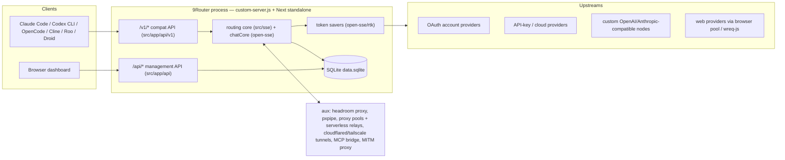
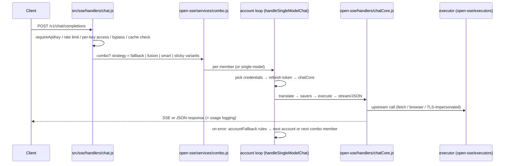
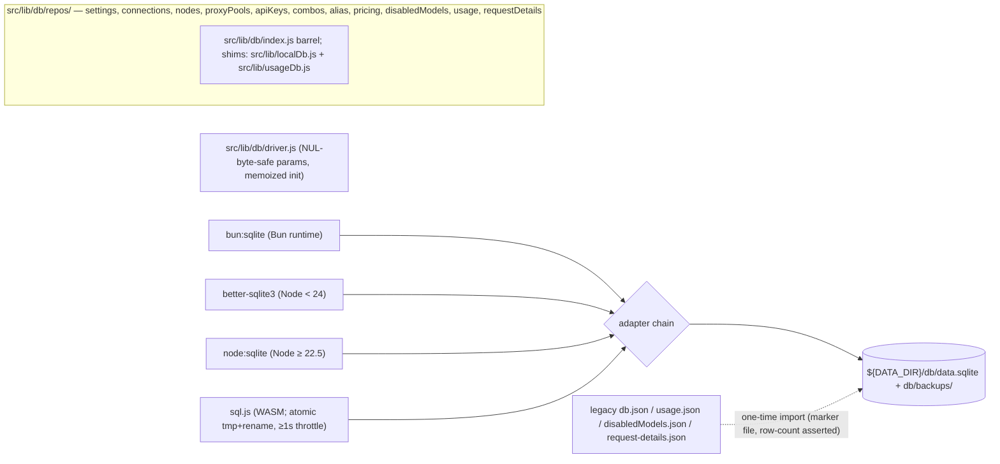

# 9Router Architecture

_Last updated: 2026-10-24. Current-state description, code-verified against the working tree. File paths are repo-relative._

## Executive Summary

9Router is a self-hosted AI gateway and management dashboard built on Next.js 16 (App Router, `output: "standalone"`). It exposes one OpenAI-compatible inference surface (`/v1/*`, plus `/v1beta/*`, `/responses`, `/codex/*` compat rewrites) and routes each request across a fleet of provider executors — OAuth account providers (Claude, Codex, Gemini CLI, Kiro, Qwen/iFlow, GitHub Copilot, Cursor, Antigravity, Qoder, Windsurf, …), cloud/API-key providers (Azure, Bedrock, Vertex, plain OpenAI/Anthropic-compatible), and browser-automation web providers (chatgpt-web, deepseek-web, grok-web, …) — with format translation, model combos (sequential fallback, round-robin, fusion, and Smart Router via System One), multi-account fallback, token refresh, quota tracking, and a token-saver subsystem (RTK filters, dedup, history GC, headroom, caveman, ponytail, pxpipe, response cache).

All persistent state lives in a single SQLite database at `${DATA_DIR}/db/data.sqlite` (driver chain: bun:sqlite → better-sqlite3 → node:sqlite ≥ 22.5 → sql.js), written through typed repos under `src/lib/db/`. The web dashboard manages connections, combos, API keys, proxy pools, tunnels, CLI-tool configs, and usage analytics. A custom HTTP server wrapper (`custom-server.js`) hardens client-IP handling and starts the background token refresher; Docker (with HEALTHCHECK), docker-compose (with the optional Headroom sidecar), a CI workflow, a docs site, and an npm CLI package (`cli/`) round out deployment.

There is no cloud component: the gateway and dashboard are one local process, all state is local, and the historical "Cloud Sync" feature has been removed (only inert remnants survive — see Known Notes / Debt).

Conventions used throughout: models are addressed as `provider/model` (e.g. `cc/claude-sonnet-5`, `cu/...` for Cursor lanes); user-facing knobs are camelCase settings keys persisted in the `settings` table; the gateway marks saver activity on responses via the `x-9router-token-saver` header (`open-sse/config/runtimeConfig.js`) and cache hits via `x-9r-cache: hit`.

Core capabilities at a glance:

- OpenAI/Anthropic/Gemini/Responses-compatible API surface for CLI tools and IDE agents
- Request/response translation across provider formats, streaming and non-streaming
- Model combos: sequential fallback, sticky round-robin, fusion (panel + judge), Smart Router (System One)
- Account-level fallback with rule-driven cooldowns and background token refresh
- OAuth and API-key provider connection management (~30 OAuth providers)
- Token savers: RTK filters, dedup, history GC, headroom, caveman/ponytail/custom prompt, pxpipe, response cache
- Per-key access control, per-key/per-IP rate limiting, SSO (OIDC + SAML), login lockout
- Usage/cost tracking with canonical cache/reasoning token accounting and per-provider quota panels
- Auxiliary ops: proxy pools + serverless relays, cloudflared/tailscale tunnels, MITM IDE aliasing, MCP bridge, headroom/pxpipe services

## Repository Layout

```
custom-server.js        HTTP server wrapper: client-IP stamping, peer token, h2c downgrade,
                        background token-refresher start; entrypoint for npm start + Docker
next.config.mjs         standalone output, /v1 rewrites, security headers, body-size limit
Dockerfile              multi-stage build (node:22.23.4-alpine), HEALTHCHECK on /api/health
docker-compose.yml      9router app + optional headroom sidecar (127.0.0.1:8787)
start.sh                local docker helper: stop / rm / build / run with named volume
cli/                    npm CLI ("9router" bin): TUI menus + tray (cli/src/cli/), postinstall
                        runtime provisioning (cli/hooks/postinstall.js, sqliteRuntime, trayRuntime)
gitbook/                standalone Next.js docs site (package name "9router-docs"),
                        deployed to GitHub Pages by CI
i18n/                   translated README mirrors (zh-CN, ja-JP, ru, es, fr, pt-BR, …)
skills/                 agent skill manifests: 9router-chat, -embeddings, -image, -stt, -tts,
                        -video, -web-fetch, -web-search (surfaced through the MCP bridge)
docs/                   this file + CODEX_STT.md
scripts/                copy-standalone-assets.mjs (postbuild), enable-token-savers.mjs,
                        injectDisplayToRegistry.mjs, migrate-registry.mjs, translate-readme.js
tests/                  vitest suites: tests/translator (golden/roundtrip/regression),
                        tests/unit, tests/auth (SAML), tests/__baseline__ (registry baselines)
open-sse/               protocol library shared by all lanes: executors/, translator/, rtk/,
                        handlers/ (chatCore, stt/tts/image/video/embedding/search/fetch cores),
                        services/, providers/ (registry + capabilities), config/, utils/, shared/
src/
  app/                  Next.js routes: api/, (dashboard)/, login/, landing/, callback/
  sse/                  app-side routing: handlers/ (chat, systemone, stt, tts, imageGeneration,
                        videoGeneration, embeddings, search, fetch), services/ (auth, model,
                        rateLimit, keyAccess, tokenRefresh, backgroundTokenRefresh,
                        antigravityQuota, systemoneRouter), utils/logger.js
  lib/                  db/ (SQLite layer), auth/, oauth/ (provider flows), tunnel/, headroom/,
                        pxpipe/, network/ (outbound proxy + relays), mcp/, modelCatalog/,
                        updater/, mitmAliasCache.js, appUpdater.js, consoleLogBuffer.js, …
  mitm/                 standalone MITM HTTPS proxy process (Antigravity/Copilot/Kiro/Cursor)
  models/, store/, shared/, i18n/   barrel exports, zustand stores, shared utils, runtime i18n
  proxy.js              root middleware (mimo login-session proxy + dashboardGuard dispatch)
  dashboardGuard.js     dashboard auth middleware (public paths, CLI token, requireLogin)
  instrumentation.js    boot hook: console capture, model-catalog sync
```

## System Context



## API Surface

Rewrites (`next.config.mjs`): `/v1/* → /api/v1/*`, `/v1beta/* → /api/v1beta/*`, `/codex/* → /api/v1/responses` (Codex CLI), `/responses → /api/v1/responses`, `/systemone → /api/v1/systemone`, and `/v1/v1/*` (doubled-prefix client bug). `/v1` request bodies are allowed up to `NINEROUTER_PROXY_CLIENT_MAX_BODY_SIZE` (default `128mb`) for long-context/base64-image clients.

### Compatibility routes (`src/app/api/`)

| Route | Purpose |
|---|---|
| `v1/chat/completions` | OpenAI chat (SSE + JSON) — main entry → `src/sse/handlers/chat.js` |
| `v1/messages`, `v1/messages/count_tokens` | Anthropic Messages format (Claude Code) |
| `v1/responses`, `v1/responses/compact` | OpenAI Responses API (Codex CLI) + context compaction |
| `v1/models`, `v1/models/info`, `v1/models/[...model]` | model catalog, per-model detail |
| `v1/embeddings` | embeddings (`open-sse/handlers/embeddingsCore.js`) |
| `v1/images/generations` | image generation — 19 provider modules in `open-sse/handlers/imageProviders/` (openai, gemini, nanobanana, blackForestLabs, falAi, comfyui, sdwebui, stabilityAi, runwayml, cloudflareAi, huggingface, codex, antigravity, chatgpt-web, gemini-web, grok-web, muse-web, uc-web, veoaifree-web) |
| `v1/videos/{generations,edits,extensions,[id]}` | video generation (`open-sse/handlers/videoCore.js`; providers: openrouter, vertex) |
| `v1/audio/{speech,transcriptions,voices}` | TTS + STT (`ttsCore.js`, `sttCore.js`, Codex OAuth STT in `codexStt.js` — lane `cx/transcribe`, 24 kHz PCM16 WAV conversion, bounded private temp files) |
| `v1/api/chat` | Ollama-compatible chat (wraps `handleChat`, applies `open-sse/utils/ollamaTransform.js`) |
| `v1/search`, `v1/web/fetch` | web search (SearXNG default) and fetch (`open-sse/handlers/{search,fetch}/`) |
| `v1/systemone` | System One (Jev) decision endpoint (`src/sse/handlers/systemone.js`) |
| `v1beta/models`, `v1beta/models/[...path]` | Gemini-style model listing |

### Management/dashboard routes (24 domains under `src/app/api/`, plus `v1`, `v1beta`)

- `auth`: `login`, `logout`, `status`, `reset-password`, and SSO: `oidc/{start,callback,test}`, `saml/{start,acs,metadata,test}`.
- `cli-tools`: settings writers for ~20 tools (`claude-settings`, `codex-settings`, `codex-profiles`, `opencode-settings`, `hermes-settings`, `hermes-profiles`, `cline-settings`, `copilot-settings`, `cowork-settings`, `cowork-mcp-registry`, `cowork-mcp-tools`, `crush-settings`, `droid-settings`, `devin-settings`, `forge-settings`, `grok-build-settings`, `jcode-settings`, `kilo-settings`, `omp-settings`, `openclaw-settings`, `pi-settings`, `smelt-settings`, `codewhale-settings`, `deepseek-tui-settings`), `all-statuses`, and `antigravity-mitm` (+ `/alias`).
- `combos` (+ `[id]`, `presets`), `keys` (+ `[id]`), `tags`, `pricing`, `locale`, `init`, `health`, `shutdown`, `version` (+ `update`, `shutdown`).
- `providers` (+ `[id]/{models,overrides,test,test-models}`, `validate`, `test-batch`, `suggested-models`, `client`, `web-login`, `kilo/free-models`) and `provider-nodes` (+ `[id]`, `validate`).
- `oauth`: per-provider connect/import flows — `codex/{bulk-import,import-token}`, `cursor/{import,auto-import}`, `kiro/{import,auto-import,api-key,social-authorize,social-exchange,import-cli-proxy}`, `zed/{import,auto-import}`, `grok-cli/bulk-import`, `xiaomi-mimo/{api-key,auto-import,login/{start,status}}`, `gitlab/pat`, `iflow/cookie`, plus generic `[provider]/[action]`.
- `proxy-pools` (+ `[id]/test`; serverless relay deploys: `netlify-deploy`, `vercel-deploy`, `cloudflare-deploy`, `deno-deploy`), `tunnel` (`enable/disable/status`, `tailscale-{check,enable,disable,install}`), `headroom` (`start/stop/restart/status/proxy/extras`), `pxpipe` (`install/start/stop/restart/status/health/stats/logs`).
- `media-providers/tts/*`: voice catalogs for `deepgram`, `elevenlabs`, `inworld`, `minimax` + aggregated `voices`.
- `models`: `alias`, `availability`, `catalog-sync`, `custom`, `disabled`, `test` (+ `test/ping.js` helper).
- `settings` (+ `database` export/import, `proxy-test`, `require-login`).
- `translator`: `load`, `save`, `send`, `translate`, `console-logs` (+ `console-logs/stream` SSE).
- `usage`: `stats`, `chart`, `history`, `logs`, `providers`, `request-details`, `request-logs`, `savers`, `stream` (live SSE), `[connectionId]` (+ `claude-reset`, `codex-reset-credits`).

## Routing & Execution Core



Entry flow in `src/sse/handlers/chat.js` (`handleChat`):

1. Parse body; strip the Claude-Code 1M-context model marker (`open-sse/utils/modelMarkers.js` — the capability travels in the `anthropic-beta` header); resolve session identity (`open-sse/utils/sessionManager.js`) for combo stickiness.
2. `settings.requireApiKey` → validate the bearer key (`src/sse/services/auth.js`); token-bucket rate limit per key or per real client IP (`src/sse/services/rateLimit.js`: `settings.rateLimitPerMinute` default 600, 0 disables; plus a 64-request concurrency cap; identities keyed on `x-9r-real-ip` which only `custom-server.js` can stamp).
3. Per-key access control (`src/sse/services/keyAccess.js`): restricted keys may call only their allow-listed combos/models, checked before bypass/expansion/credential lookup.
4. Bypass handling for naming/warmup probes (`open-sse/utils/bypassHandler.js`, gated by `settings.ccFilterNaming`).
5. Response-cache check (`open-sse/services/responseCache.js`): opt-in exact-request cache for non-streaming chat (`responseCacheEnabled`, `responseCacheTtlMs`, `responseCacheMaxEntries`); hits served with `x-9r-cache: hit`, checked before any credential lookup, filled only from JSON 2xx upstream answers via `clone()`.
6. Combo resolution (`getComboModels` from `src/sse/services/model.js`): strategy per combo via `settings.comboStrategies[name].fallbackStrategy`, falling back to `settings.comboStrategy`:
   - `fallback` — sequential member rotation (`handleComboChat` in `open-sse/services/combo.js`);
   - sticky round-robin — `comboStickyRoundRobinLimit`, per-session rotation state;
   - `fusion` — parallel panel + judge (`handleFusionChat`): panel answers capped (`fusionTuning.panelAnswerCapChars`, default 24,000 chars, 0 disables) before the judge; quorum + straggler grace + hard timeout; losing panel bodies cancelled after quorum; panel requests have tools stripped;
   - `smart` — Smart Router (System One): `resolveSmartChoice` (`src/sse/services/systemoneRouter.js` wrapping pure logic in `open-sse/services/systemoneRouter.js`), default router model `oc/jev-1.13-free`, 8s timeout, prompt state capped at 2,000 chars, in-memory session stickiness (2h TTL, 5,000 sessions) to retain prompt cache, `confidenceThreshold` default 0.8, `smartPolicy` = Smart Switch / Strict Lock / Per-Turn; Ollama `clef`/`clef-flash` supported as decision models.
7. Capability augmentation (`open-sse/services/capacityAdapter.js`): requests needing a capability the target lacks (e.g. vision) get an adapter model inserted; adapter additions are stripped from the client-visible response and re-checked against per-key access.
8. `handleSingleModelChat` account loop: `getProviderCredentials` (skips excluded/locked connections) → `checkAndRefreshToken` (`src/sse/services/tokenRefresh.js`) → Antigravity/Gemini-CLI cold-miss project-ID fix (`open-sse/services/projectId.js`) → `handleChatCore`. On failure, `markAccountUnavailable` consults the rule table in `open-sse/services/accountFallback.js` (rules in `open-sse/config/errorConfig.js`): credential-fault errors rotate accounts with exponential backoff (1s → 2s → 4s → … max 4 min); request-scoped 4xx (context overflow, unsupported parameter, validation) set `requestScoped` and advance the combo without locking a healthy account; insufficient-credit/balance 400s advance combos. Antigravity 409/429 goes through `src/sse/services/antigravityQuota.js` to fetch exact upstream reset times; the resulting model lock is RAM-only, never persisted. When every account is rate-limited the handler returns 503 with `retryAfter` metadata.

`open-sse/handlers/chatCore.js` then performs, in order: client/tool detection (`open-sse/utils/clientDetector.js`) and native-passthrough detection; MCP-equivalent built-in tool dedup (`open-sse/utils/toolDeduper.js`); OpenCode fingerprint tool-name capture/restore; request translation to the provider format (`open-sse/translator/`); token-saver passes (below); executor invocation (`open-sse/executors/index.js`, `getExecutor`); and response handling split into `chatCore/{streamingHandler,nonStreamingHandler,sseToJsonHandler,requestDetail}.js` (forced SSE→JSON conversion for JSON-mode clients). Notable behaviors: `stripContinuityFields` removes translator-internal reasoning/`encrypted_content` blobs from outbound bodies (older assistant turns keep only what upstream needs); a 400 naming a thinking/reasoning parameter auto-strips thinking params and retries once; streams that return HTTP 200 but zero content frames trigger empty-failover (`open-sse/services/emptyFailover.js`, peek deadline + 1 MiB head cap via `EMPTY_PEEK_HEAD_CAP_BYTES`); aborted client connections record an "aborted" request-detail row instead of a false success; non-JSON upstream frames emit an error frame rather than a clean `[DONE]` so clients see truncation; missing tool-call `id`s are synthesized for strict OpenAI clients.

Token refresh is deduped process-wide (`open-sse/services/tokenRefresh/{dedup,providers}.js`) so concurrent 401s cannot double-spend single-use refresh tokens (Kimi); credential updates persist through `updateProviderCredentials` callbacks. A background scheduler (`src/sse/services/backgroundTokenRefresh.js`) refreshes expiring credentials; it is started both by app bootstrap and by `custom-server.js` (whichever boots first, idempotent).

### Model resolution

Before a request reaches an executor, the model string is resolved in `src/sse/services/model.js` (localDb-aware wrapper over `open-sse/services/model.js`):

1. `parseModel` splits `provider/model`; local provider-alias overrides are applied on top of the open-sse registry map (e.g. `xmtp` → `xiaomi-tokenplan`).
2. User-defined provider-node prefixes are matched next — `openai-compatible`, `anthropic-compatible`, and `custom-embedding` nodes (`providerNodes` table, managed via `/api/provider-nodes`). Prefixes cannot shadow reserved built-in provider ids/aliases (`openai`, `cc`, `cu`, `cf`, …), which are collected from the registry into a reserved set.
3. Bare model names resolve through the alias map (`kv` scope `modelAliases`, `repos/aliasRepo.js`), then custom models (`customModels` scope), with per-provider disabled-model filtering (`repos/disabledModelsRepo.js`, `/api/models/disabled`).
4. Combo names resolve to ordered model lists (`getComboByName`; combos table + presets). Combo presets for Cursor and Claude Code clients are generated by `src/lib/comboPresets.js` (names match client-native model IDs, seeded with prefixed 9router models; exposed via `/api/combos/presets`). Per-provider `max_tokens` body overrides and custom headers ride on `settings.providerOverrides[provider]` (managed via `/api/providers/[id]/overrides`).

### Request logging and usage capture

Every request through `chatCore` gets a request-detail record (headers sanitized, `x-9r-cli-token`-style secrets redacted) and a usage row. Streaming responses accumulate usage in `buildOnStreamComplete`; non-streaming responses parse the upstream JSON. `statsEmitter` (usageRepo) feeds `/api/usage/stream`, and `trackPendingRequest`/`getActiveRequests` power the live in-flight view.

## Provider Executor Fleet

47 executor keys registered in `open-sse/executors/index.js` (41 executor modules; extra keys are aliases/variants, e.g. `qoder-cn`, `vertex-partner`, `br`/`brx` Bedrock lanes). Categories:

- **OAuth/account providers**: `antigravity`, `codex`, `gemini-cli`, `github`, `kiro`, `iflow`, `qoder` (+cn), `kimchi`, `cursor`, `xiaomi-mimo`, `xiaomi-tokenplan`, `minimax-code` (+global), `codebuddy-cn`/`codebuddy-intl`, `trae`, `zed`, `windsurf`, `commandcode`, `mimo-free`, `grok-cli`, `devin-cli`, `opencode`, `opencode-go`, `opencode-zen`.
- **Cloud / API-key**: `azure`, `bedrock` (+variants), `vertex`, and `default.js` — plain OpenAI-compatible / Anthropic-compatible providers and user-registered custom nodes.
- **Web providers** (browser automation): `chatgpt-web`, `deepseek-web`, `gemini-web`, `muse-web`, `uc-web`, `veoaifree-web`, `perplexity-web`, `grok-web`. Shared infrastructure: `open-sse/services/browserPool.js` (shared browser pool), `browserProfileCache.js`, `webIdentity.js`, `webLogin.js`/`webLoginConfig.js` (session-cookie capture); `grokTlsClient.js` provides wreq-js TLS impersonation for grok-web. Heavy runtimes (playwright-core, wreq-js) are lazily downloaded into `${DATA_DIR}/runtime` by `open-sse/services/lazyRuntime.js` (see `comment_playwright_core` in `package.json`; browsers are not bundled — `npx playwright-core install chromium` or a stealth CDP endpoint is required).

Provider metadata lives in `open-sse/providers/`: per-provider registry modules (`providers/registry/`), model tables (`providers/models/`), `capabilities.js` (context windows, vision/thinking support), `pricing.js`, `thinkingLevels.js`, `visionPatterns.js`. A remote catalog sync (`src/lib/modelCatalog/sync.js` + `open-sse/providers/catalogOverride.js`, triggered at boot by `src/instrumentation.js` and on demand via `/api/models/catalog-sync`) overrides the static tables. OAuth flows for ~30 providers are implemented in `src/lib/oauth/providers/` with shared token services in `src/lib/oauth/services/`; connection records live in the `providerConnections` table.

### Connection lifecycle

1. **Connect**: `/api/oauth/[provider]/[action]` (and dedicated import/bulk-import routes) run the provider flow from `src/lib/oauth/providers/`, persisting credentials into `providerConnections` (auth type oauth vs api-key, priority, isActive, provider-specific data blob).
2. **Validate**: `/api/providers/[id]/test`, `/test-models`, `/api/providers/test-batch`, `/api/providers/validate` probe connections; results update `testStatus`.
3. **Rotate**: account selection in `getProviderCredentials` respects priority ordering (`reorderProviderConnections` API), active flags, and per-model lockouts; `cleanupProviderConnections` removes dead rows.
4. **Refresh**: `checkAndRefreshToken` (inline, deduped) + `backgroundTokenRefresh.js` (scheduled) keep OAuth tokens warm; refreshed credentials persist via `updateProviderCredentials` and reset `testStatus` to active.
5. **Revoke**: delete via `/api/providers/[id]`; per-provider bulk delete (`deleteProviderConnectionsByProvider`).

## Translation Layer

`open-sse/translator/` converts between client format and provider format per request, response, and stream frame:

- Source/target formats: OpenAI chat, Anthropic Messages, OpenAI Responses, Gemini (`formats/{openai,claude,responsesApi,gemini,maxTokens}.js`; endpoint-based detection via `detectFormatByEndpoint`).
- Request transformers (`translator/request/`): openai↔claude, openai→gemini, openai→kiro, claude→kiro, openai→cursor, openai→commandcode, openai→ollama, openai→vertex, gemini→openai, antigravity→openai, openai-responses.
- Response transformers (`translator/response/`): the inverse set including kiro→claude, cursor→openai, ollama→openai.
- Cross-cutting concerns (`translator/concerns/`): unified thinking mapping (`thinkingUnified.js`), reasoning extraction/injection, message/chunk normalization, tool-call shaping (`toolCall.js`), modality stripping, image handling + prefetch, JSON mode, finish-reason mapping, usage normalization, Kiro conversation shape, parameter-support filtering.
- Contract tests: golden files and round-trips in `tests/translator/` (e.g. `golden-request.test.js`, `format-roundtrip.test.js`, `bugs-*.test.js`).

## Token-Saver Subsystem

Request-body compression passes applied in `chatCore` on the source-format body, before translation (`open-sse/rtk/`), each independently toggleable in settings:

- **RTK filters** (`rtk/filters/`, 13 filters: `buildOutput`, `testRunner`, `gitDiff`, `gitLog`, `gitStatus`, `grep`, `find`, `ls`, `readNumbered`, `tree`, `dedupLog`, `searchList`, `smartTruncate`), autodetected per tool result (`rtk/autodetect.js`, `testRunner` autodetected before `buildOutput` so failed test runs keep failure details); enabled via `settings.rtkEnabled`.
- **Dedup**: byte-identical tool results later in one request body elided to `duplicate of tool result #N` (`rtk/dedup.js`, `settings.rtkDedupEnabled` default on; skips `is_error` results).
- **History GC**: tool results older than the last N user turns squashed to a digest (head + size + fingerprint + re-run hint) (`rtk/historyGc.js`, `settings.historyGcEnabled` opt-in, `historyGcKeepTurns` default 6). OpenAI, Claude, Responses, and Kiro body shapes supported.
- **System-prompt savers**: `caveman` (level-tuned prompt compression, `cavemanPrompts.js`), `ponytail` (`ponytailPrompt.js`), and user-authored `customPrompt` injected across OpenAI/Responses/Claude/Gemini/Kiro shapes (`rtk/{caveman,ponytail,customPrompt,systemInject}.js`).
- **Headroom**: external tool-output compression proxy (`rtk/headroom.js` → `${HEADROOM_URL}`, `settings.headroomEnabled`, `headroomCompressUserMessages`, `headroomTimeoutMs`; phantom-savings detection included).
- **pxpipe**: image compression loaded as an in-process library (`rtk/pxpipe.js` + `src/lib/pxpipe/{install,loader,service,events}.js`), fail-open when not installed; `/api/pxpipe/install` is localhost-only.
- **Response cache**: exact-request cache for non-streaming chat (`open-sse/services/responseCache.js`, LRU + TTL; see routing core).

Live counters in `open-sse/services/saverStats.js` (globalThis store, survives dev hot-reload; counters only: rtk/dedup/gc hits + bytes, headroom hits, caveman/ponytail/custom-prompt hits, pxpipe images, response-cache hits) feed the `/api/usage/savers` scoreboard (POST resets) and the dashboard Token Saver and Usage pages. `scripts/enable-token-savers.mjs` flips the safe saver set (RTK + dedup + history GC, optional `--response-cache`, `--smart-combo`, `--revert`, `--dry-run`) directly in the local DB.

## Persistence Layer



- Path constants in `src/lib/db/paths.js`: `DB_DIR = ${DATA_DIR}/db`, `DATA_FILE = ${DATA_DIR}/db/data.sqlite`, `BACKUPS_DIR`, and the legacy JSON file list. `DATA_DIR` resolution (`src/lib/dataDir.js`): env `DATA_DIR` → default `~/.9router` (macOS/Linux) or `%APPDATA%\9router` (Windows; Unix-style absolute values are ignored there; unwritable paths fall back with a warning).
- Driver selection (`src/lib/db/driver.js`): Bun → `bun:sqlite`; Node < 24 → `better-sqlite3` (skipped on ≥ 24 — the native addon SIGSEGVs); `node:sqlite` on ≥ 22.5; `sql.js` WASM as last resort. All bound strings are stripped of NUL bytes at the binding boundary (`src/lib/db/helpers/nullBytes.js`) so raw-binary values cannot abort writes or silently truncate.
- Schema (`src/lib/db/schema.js`): tables `_meta`, `settings`, `providerConnections`, `providerNodes`, `proxyPools`, `apiKeys` (with per-key access-control columns), `combos`, `kv` (scopes: `modelAliases`, `customModels`, `mitmAlias`, `pricing`), `usageHistory`, `usageDaily`, `requestDetails`.
- Migrations (`src/lib/db/migrations/001-initial.js`, runner `migrate.js`): fresh-DB bootstrap creates all tables idempotently; legacy JSON state is imported once with marker file `db/.migrated-from-json`; every import asserts row counts and throws `MigrationAborted` (rollback, legacy file intact, retried next boot). Backups via `src/lib/db/backup.js` (lightweight DB backups + pruning).
- Hot path: settings reads are memoized 500ms (`repos/settingsRepo.js`) — the chat path reads settings many times per request. Full export/import (`exportDb`/`importDb`) backs `/api/settings/database`.

## Auth & Security

- **Dashboard session** (`src/lib/auth/dashboardSession.js`): JWT HS256 (jose), 24h expiry, httpOnly `auth_token` cookie (SameSite=Lax); Secure forced by `AUTH_COOKIE_SECURE=true` or an https-forwarded request. Password stored as a bcrypt hash in settings; `verifyDashboardPassword` accepts the hash, else the initial password.
- **Initial password**: `INITIAL_PASSWORD` env wins; otherwise a random value generated once per install, persisted at `${DATA_DIR}/initial-password` (mode 0600) and printed to the console at generation; the file is deleted once a real password is set (`clearInitialPasswordFile`, invoked by the settings PUT route — `src/app/api/settings/route.js`). The `123456` literal survives only as a last-resort constant in code — it is not the shipped credential (the login page still displays stale text claiming it is; see Known Debt). `/api/auth/reset-password` and `/api/auth/status` round out the credential surface.
- **JWT secret**: `JWT_SECRET` env, else auto-generated to `${DATA_DIR}/jwt-secret` (0600).
- **Login limiter** (`src/lib/auth/loginLimiter.js`): in-memory progressive lockout keyed by trusted IP — 5 failures within 1h → escalating locks of 30s / 2m / 10m / 30m; resets on process restart; trusted-peer requests (CLI) are exempt.
- **SSO**: OIDC (`src/lib/auth/oidc.js`, routes `/api/auth/oidc/{start,callback,test}`) and SAML (`src/lib/auth/saml.js` on @node-saml, routes `/api/auth/saml/{start,acs,metadata,test}`). Redirect-base resolution: `settings.baseUrl` → `BASE_URL`/`NEXT_PUBLIC_BASE_URL` env → forwarded proto/host.
- **Middleware** (`src/dashboardGuard.js`, dispatched from `src/proxy.js`): public paths (`/api/health`, `/api/init`, `/api/locale`, `/api/auth/{login,logout,status,oidc*,saml*}`, `/api/version`, `/api/settings/require-login`) and public LLM prefixes (`/v1`, `/v1beta`, `/api/v1`, `/api/v1beta`, `/codex`, `/responses`) pass through — the LLM surface does its own key auth. Everything else requires a session when `settings.requireLogin` is enabled (default on). The bundled CLI authenticates with `x-9r-cli-token` (machine-ID-derived). `src/proxy.js` also guards the Xiaomi mimo login-session cookie flow (`src/lib/mimoLoginSession.js`): a forged `9r_mimo_login` cookie without a dashboard session is dropped, never forwarded.
- **Trusted peer** (`src/lib/auth/trustedPeer.js`): `x-9r-real-ip` is honored only when `custom-server.js` stamped it, proven by the per-process `NINEROUTER_PEER_TOKEN`; client-supplied `x-forwarded-for`/`x-real-ip`/`x-9r-*` headers are stripped (trusted only from loopback proxies), so rate limiting and lockout key on the unspoofable socket address.
- **API keys**: hashed keys with per-key access control (`apiKeysRepo` + `src/sse/services/keyAccess.js`); enforcement is the `settings.requireApiKey` flag (no `REQUIRE_API_KEY` env read).
- **Rate limiting**: per-key/per-IP token bucket + concurrency cap on `/v1` (`src/sse/services/rateLimit.js`).
- **Secret stripping**: providers API list/detail responses drop secret-bearing `providerSpecificData` keys (copilotToken, clientSecret, mimoPassToken, cookies, …); the translator console masks `Authorization`/`x-api-key`/cookie values and `/api/translator/*` always requires dashboard auth even when `requireLogin=false`; the headroom proxy viewer strips cookies/Authorization unconditionally.
- **Security headers** (`next.config.mjs`): CSP, `X-Frame-Options: DENY`, `X-Content-Type-Options: nosniff`, `Referrer-Policy: strict-origin-when-cross-origin` on all routes.

Gateway-internal request/response headers (all set server-side; client-supplied copies are stripped):

| Header | Meaning |
|---|---|
| `x-9r-real-ip` | trusted client IP, stamped only by `custom-server.js` |
| `x-9r-peer-token` | per-process proof that `x-9r-real-ip` is server-stamped |
| `x-9r-via-proxy` | request arrived through a forwarding proxy |
| `x-9r-cli-token` | machine-bound dashboard auth for the bundled CLI |
| `x-9r-cache: hit` | answer served from the exact-request response cache |
| `x-9router-token-saver` | saver activity summary on the response |

## Auxiliary Services

- **Headroom** (external tool-output compression proxy): detection/process management in `src/lib/headroom/{detect,process}.js`; lifecycle routes `/api/headroom/{start,stop,restart,status,proxy,extras}`; docker-compose runs `ghcr.io/chopratejas/headroom` bound to `127.0.0.1:8787` with `HEADROOM_URL=http://headroom:8787`.
- **pxpipe**: npm-installed image-compression module loaded in-process (`src/lib/pxpipe/`); `/api/pxpipe/install` is localhost-only; health/stats/logs routes back the dashboard page.
- **Proxy pools & serverless relays**: pool CRUD in `repos/proxyPoolsRepo.js` + `/api/proxy-pools` (+ `[id]/test`); one-click relay deployment routes build and deploy outbound fetch-relay functions to Netlify (`src/lib/network/netlifyRelay.js` builds the function zip), Vercel, Cloudflare, and Deno Deploy. Outbound proxy support: `src/lib/network/{outboundProxy,initOutboundProxy,connectionProxy,proxyTest}.js` — honors `HTTP(S)_PROXY`/`ALL_PROXY`/`NO_PROXY` (+ lowercase), per-pool assignment, and a settings proxy-test route.
- **Tunnels**: Cloudflare (cloudflared child process; `src/lib/tunnel/cloudflare/{manager,cloudflared,config,healthCheck,pid}.js`) and Tailscale (`src/lib/tunnel/tailscale/`) managers with a shared watchdog/health-check (`src/lib/tunnel/shared/`), controlled via `/api/tunnel/*`.
- **MCP server**: `/api/mcp/[plugin]/{sse,message}` bridges stdio MCP servers to SSE (`src/lib/mcp/stdioSseBridge.js`), exposing gateway skills (`skills/`) as MCP tools; cowork MCP registry/tools surfaced under `/api/cli-tools/cowork-mcp-*`.
- **Media providers**: TTS voice catalogs (`/api/media-providers/tts/{deepgram,elevenlabs,inworld,minimax}/voices` + aggregated `/voices` mapping providers to internal APIs), 10 TTS engine modules in `open-sse/handlers/ttsProviders/` (edge-tts, elevenlabs, gemini, google, minimax, openai, openrouter, xiaomi-mimo, local-device, self-hosted), STT via `sttCore.js` and Codex OAuth transcription (`codexStt.js`).
- **Translator console**: request/response step inspection and live rule editing (`/api/translator/{load,save,send,translate,console-logs}` + SSE stream `console-logs/stream`; dashboard page `dashboard/translator`); always dashboard-auth-gated.
- **MITM aliasing**: standalone HTTPS/H2 MITM process (`src/mitm/server.js`, local port 443, per-domain certificates from `src/mitm/cert/`, SNI-based) that rewrites model IDs for Antigravity/Copilot/Kiro/Cursor IDE traffic; per-tool handlers in `src/mitm/handlers/{antigravity,copilot,kiro,cursor}.js`; alias mappings read from the DB (`src/mitm/dbReader.js`, cached via `src/lib/mitmAliasCache.js`) and managed via `/api/cli-tools/antigravity-mitm/alias`; includes an IDE-version override (`src/mitm/antigravityIdeVersion.js`) and host rewrites for rate-limited upstreams. Runs as a child process (Dockerfile copies `src/mitm/` explicitly for this).
- **Web search / fetch**: `/v1/search` (SearXNG default via `SEARXNG_URL`; normalizers/callers in `open-sse/handlers/search/`), `/v1/web/fetch` (`open-sse/handlers/fetch/`).
- **Updater**: runtime self-update with full-content comparison reuse (`src/lib/updater/updater.js`, `src/lib/appUpdater.js`, `/api/version/update` + `/api/version/shutdown` for restart).

## Dashboard UI Route Map (`src/app/`)

| Route | Page |
|---|---|
| `/` → landing | `landing/page.js` (marketing; contains a stale Cloud Sync card — see Known Debt) |
| `/login` | `login/page.js` (has stale "Default password is 123456" text — see Known Debt) |
| `/callback` | OAuth callback page (`callback/page.js`) |
| `/dashboard` | overview (`(dashboard)/dashboard/page.js`) |
| `/dashboard/basic-chat` | built-in chat playground |
| `/dashboard/cli-tools` | CLI tool config cards (Claude, Codex, OpenCode, Hermes, … + `[toolId]` detail) |
| `/dashboard/combos` | combo editor incl. Smart Router (System One) picker (`SmartPolicyModal`) |
| `/dashboard/console-log` | captured server console ring buffer |
| `/dashboard/endpoint` | endpoint / API-key management |
| `/dashboard/media-providers` | TTS/STT provider setup |
| `/dashboard/mitm` | MITM aliasing manager |
| `/dashboard/profile` | account / password |
| `/dashboard/providers` | provider connections, custom nodes, overrides |
| `/dashboard/proxy-pools` | pools + serverless relay deploys |
| `/dashboard/pxpipe` | pxpipe control |
| `/dashboard/quota` | per-connection quota tracking + anchored auto-ping schedule |
| `/dashboard/skills` | MCP / skill registry |
| `/dashboard/token-saver` | saver toggles (dedup, history GC + keep-turns, response cache) |
| `/dashboard/translator` | translator console |
| `/dashboard/usage` | usage analytics + Token Saver Scoreboard card (30s auto-refresh) |

State: zustand stores in `src/store/` (settings, providers, notifications, theme, header search); runtime i18n in `src/i18n/` (locale API `/api/locale`); shared UI components/constants/hooks in `src/shared/`.

## Quota Tracking & Usage Analytics

- Per-request usage is captured in `chatCore` (`open-sse/utils/usageTracking.js`) and persisted via `src/lib/db/repos/usageRepo.js` into `usageHistory` (raw rows) and `usageDaily` (rollups); per-request inspection rows go to `requestDetails` (`requestDetailsRepo.js`, retention gated by `OBSERVABILITY_ENABLED` default-on and `ENABLE_REQUEST_LOGS`).
- **Canonical token conventions**: `prompt_tokens` is cache-inclusive; the cached subset is read from all three storage shapes (`cached_tokens`, `cache_read_input_tokens`, nested `prompt_tokens_details.cached_tokens`) everywhere it is aggregated. `completion_tokens` is reasoning-inclusive — reasoning (nested `completion_tokens_details.reasoning_tokens`) is billed once at its own rate, never double-charged at output + reasoning. `cacheHitRate` = `totalCachedTokens / totalPromptTokens` per period (`usageRepo.js`).
- Endpoints: `/api/usage/{stats,chart,history,logs,providers,request-details,request-logs,savers,stream}` (live SSE stream) and per-connection quota resets (`[connectionId]/claude-reset`, `[connectionId]/codex-reset-credits`).
- Provider quota extractors in `open-sse/services/usage/` (claude, codex, cursor, kiro, google/antigravity-weekly, github, glm, kimi, minimax, deepseek, grok-cli, groq, opencode-go, opencode-zen, codebuddy-cn, commandcode, xiaomi-mimo, zed, misc/shared helpers) surface remaining quota on the dashboard quota page, with anchored auto-ping schedules (fixed local times, timezone/DST-aware).

## Deployment Topology

- **Local dev**: `npm run dev` (Next dev, port 20127). **Production**: `npm run build` (`next build --webpack`, then `scripts/copy-standalone-assets.mjs`) and `npm start` → `node custom-server.js --port 20127`. Bun lanes also exist (`build:bun`, `start:bun`).
- **custom-server.js**: wraps `http.createServer` — derives client IP from the TCP socket, strips client-supplied forwarding headers (trusting them only from loopback proxies), stamps `x-9r-real-ip` + per-process `x-9r-peer-token`, downgrades HTTP/2 cleartext upgrades (JBR 25 clients) to HTTP/1.1 replay, and starts the background token refresher on `listening`. Loads the standalone `server.js` when present, else re-executes `next start` — the wrapper applies in both cases. `NEXT_TRACING_ROOT_MODE=workspace` redirects Next file-tracing to the monorepo root for CLI bundling; `serverExternalPackages` keeps better-sqlite3, sql.js, open, @aws-sdk/credential-providers, and wreq-js external (native/runtime path requirements).
- **Docker** (`Dockerfile`): multi-stage on `node:22.23.4-alpine`; runner copies the standalone build plus `open-sse/`, `src/mitm/` (MITM child process), and runtime-critical node_modules (sql.js WASM binary, node-machine-id, node-forge, next); runs as non-root via `su-exec` entrypoint; ships `ffmpeg` (media); `DATA_DIR=/app/data`, `PORT=20128`; `HEALTHCHECK` polls `/api/health` every 30s (5s timeout, 20s start period, 3 retries). `start.sh` = local stop/rm/build/run with the `9router-data` volume. `docker-compose.yml` adds the optional headroom sidecar and sets `HEADROOM_URL`. Build args support regional Alpine mirrors and npm registry overrides (`ALPINE_MIRROR`, `NPM_REGISTRY`).

### Port map

| Port | Use |
|---|---|
| 20127 | dev server (`npm run dev`, `npm start` default) |
| 20128 | Docker/published port (`PORT` env; docker-compose maps `20128:20128`) |
| 8787 | optional Headroom sidecar (bound to `127.0.0.1` in compose) |
| 443 (local) | MITM proxy listener (`src/mitm/server.js`) when aliasing is enabled |
- **CLI package** (`cli/`, npm name `9router`, bin `9router`): terminal UI (`cli/src/cli/{menus,commands,api,tray,utils,terminalUI.js}`), machine-bound CLI token, and postinstall hooks that provision a bundled app copy and SQLite runtime (`cli/hooks/{postinstall,sqliteRuntime,trayRuntime}.js`). Root `package.json` scripts `cli:pack` / `cli:publish`.
- **CI/CD** (`.github/workflows/`): `ci.yml` (ESLint over `src open-sse scripts`, provider-registry baseline verifies — `tests/__baseline__/verify-{providers,alias,oauth-urls}.mjs` — and a Next build), `docker-publish.yml` (image build/push), `gitbook-pages.yml` (docs site → GitHub Pages), `tray-binaries.yml` (macOS arm64 tray binary).

## Observability

- `/api/health` liveness endpoint (CORS-open GET) — used by the Docker HEALTHCHECK, tunnel pinger, and in-app model test routes.
- Console capture ring buffer (`src/lib/consoleLogBuffer.js`, initialized by `src/instrumentation.js`) → `/dashboard/console-log` and `/api/translator/console-logs`.
- Structured request logs with per-session colors (`src/sse/utils/logger.js`); the unified "▶" routing line (client model → provider/model → account) is emitted in `chatCore`. Log tags in active use include `CHAT`, `AUTH`, `FALLBACK`, `RATELIMIT` (see `src/sse/handlers/chat.js`); sensitive values are masked (`log.maskKey` for API keys).
- Request-detail rows and request logs (`requestDetailsRepo`, `usageRepo.appendRequestLog`) power `/api/usage/request-details` and `/api/usage/request-logs`.
- Live usage SSE stream (`/api/usage/stream`), saver scoreboard (`/api/usage/savers`), pxpipe stats/logs (`/api/pxpipe/{stats,logs}`), headroom status (`/api/headroom/status`), tunnel status (`/api/tunnel/status`).
- Model catalog sync at boot (`src/instrumentation.js` → `src/lib/modelCatalog/sync.js`).

## Testing

- **Translator contract** (`tests/translator/`, 20 suites): golden request/response/stream files, format round-trips, per-client regression suites named `bugs-*.test.js` (claudeCode, codexCli, gemini-cursor, deepseek tool types, kiro, openai-bridge), thinking-unified and coverage-all-models matrices.
- **Unit suites** (`tests/unit/`, ~370 files): per-provider executor behavior (antigravity quota/billing/streams, kimi refresh, codex, cursor, qoder, …), account fallback semantics, capacity adapter, savers, DB adapters, auth.
- **Auth** (`tests/auth/saml.test.js`): SAML flow unit tests.
- **Baselines** (`tests/__baseline__/`): `verify-providers.mjs`, `verify-alias.mjs`, `verify-oauth-urls.mjs` fail CI on registry drift; `snapshot-providers.mjs` regenerates `providers-baseline.json`; `known-fails.txt` tracks accepted failures.
- **Runner**: vitest (`tests/vitest.config.js`, node env, concurrency 60 for provider smoke runs); live upstream tests are opt-in via `RUN_LIVE=1` (e.g. `tests/unit/mimo-free.live.test.js`).

## Environment Matrix

Verified as actually read by code:

| Variable | Used in | Notes |
|---|---|---|
| `JWT_SECRET` | `src/lib/auth/dashboardSession.js` | auto-generated to `DATA_DIR/jwt-secret` if unset |
| `INITIAL_PASSWORD` | `src/lib/auth/dashboardSession.js` | overrides the generated initial dashboard password |
| `DATA_DIR` | `src/lib/dataDir.js` | default `~/.9router` / `%APPDATA%\9router`; Docker `/app/data` |
| `PORT` | Dockerfile env, `src/lib/appUpdater.js`, `src/app/api/models/test/ping.js` | dev 20127, Docker 20128 |
| `NODE_ENV` | runtime | `production` in Docker |
| `API_KEY_SECRET` | `src/shared/utils/apiKey.js` | endpoint API-key derivation |
| `MACHINE_ID_SALT` | `src/shared/utils/machineId.js` | machine-ID hashing salt (CLI token derivation) |
| `ENABLE_REQUEST_LOGS` | `src/app/api/settings/route.js`, `src/lib/db/repos/requestDetailsRepo.js` | `"true"` enables raw request logging |
| `OBSERVABILITY_ENABLED` | `src/lib/db/repos/requestDetailsRepo.js` | default enabled; `"false"` disables detail retention |
| `AUTH_COOKIE_SECURE` | `src/lib/auth/dashboardSession.js` | force Secure cookie |
| `HEADROOM_URL` | `src/lib/headroom/detect.js`, `settingsRepo.js` | default `http://localhost:8787`; set by docker-compose |
| `HTTP_PROXY`/`HTTPS_PROXY`/`ALL_PROXY`/`NO_PROXY` (+ lowercase) | `src/lib/network/outboundProxy.js` | outbound proxy for upstream provider calls |
| `SEARXNG_URL` | `open-sse/config/runtimeConfig.js` → `open-sse/providers/registry/searxng.js` | default `http://localhost:8888/search` |
| `EMPTY_PEEK_HEAD_CAP_BYTES` | `open-sse/config/runtimeConfig.js` | empty-failover peek cap (default 1 MiB) |
| `NINEROUTER_PROXY_CLIENT_MAX_BODY_SIZE` | `next.config.mjs` | `/v1` request body limit, default `128mb` |
| `NINEROUTER_PEER_TOKEN` | `custom-server.js`, `src/lib/auth/trustedPeer.js` | generated per-process at boot; not user-set |
| `NEXT_TRACING_ROOT_MODE` | `next.config.mjs`, `custom-server.js` | `workspace` for CLI bundling |
| `DEBUG_BACKGROUND_TOKEN_REFRESH` | `custom-server.js` | verbose refresher diagnostics |
| `BASE_URL` / `NEXT_PUBLIC_BASE_URL` | `src/lib/auth/oidc.js`, `src/lib/auth/saml.js` | live: SSO redirect-base fallback (after `settings.baseUrl`) |
| `CLOUD_URL` / `NEXT_PUBLIC_CLOUD_URL` | `settingsRepo.js getCloudUrl()`; cli-tools UI cards (`ClaudeToolCard.js`, `DroidToolCard.js`, `ToolDetailClient.js`) | vestigial: only read by leftover cloud-sync helpers and "endpoint configured" matching; no sync feature exists |
| `INSTANCE_NAME` | none | listed as unused reference in `.env.example` |

The "Cloud sync variables" block in `.env.example` is stale documentation for the removed feature — except that `BASE_URL` retains a real, live role (SSO). Webhook-style upper/lowercase proxy vars are both honored.

## Process Model & In-Memory State

The gateway is a single Node/Bun process (plus optional child processes: MITM proxy, cloudflared/tailscale, and — in docker-compose — the external headroom sidecar). State that intentionally lives only in memory:

- Rate-limit buckets and in-flight counters — `globalThis._9rRateLimit` (`src/sse/services/rateLimit.js`); the design assumes one process (see the module header: the auth selection mutex is also process-local).
- Saver scoreboard — `globalThis._9rSaverStats` (`open-sse/services/saverStats.js`); resets on restart by design.
- Combo rotation indices, fusion state, and Smart Router session-stickiness map — module state in `open-sse/services/combo.js` and `systemoneRouter.js` (stickiness: 5,000 sessions, 2h TTL).
- Account lockouts/backoff levels — in `src/sse/services/auth.js` selection state; Antigravity quota locks deliberately RAM-only.
- DB adapter singleton — `global._dbAdapter` (`src/lib/db/driver.js`) to survive Next dev hot-reload; ditto the console capture buffer.

Everything else (connections, keys, combos, settings, usage, request details, aliases, pricing) is durable in SQLite.

## Performance Notes

- Settings reads are memoized 500ms (`repos/settingsRepo.js`) — the chat path consults settings repeatedly per request (previously up to ~26 reads/request).
- sql.js fallback throttles exports to ≥1s and persists atomically (tmp+rename) so WASM serialization cost stays bounded.
- `next.config.mjs` tunes compile/bundle: `optimizePackageImports` tree-shakes heavy barrels (@xyflow/react, @dnd-kit, material-symbols, marked), webpack watch excludes non-source dirs, images are unoptimized, and `/v1` body size is capped (`proxyClientMaxBodySize`).
- `serverExternalPackages` keeps native/runtime-path-sensitive deps out of the bundle (see Deployment Topology).
- Long-context and base64-image requests are first-class: the doubled `/v1/v1/` rewrite and 128 MB default body limit exist specifically for chunky agent clients.

## Failure Modes & Resilience

- **Account rotation**: rule-driven (`open-sse/config/errorConfig.js` `ERROR_RULES`, text- and status-based, provider-scoped); exponential backoff per credential (1s → max 4 min) with transient cooldowns; request-scoped 4xx rotate the combo member, not the account; credit/balance 400s advance combos; Antigravity quota locks stay in RAM until upstream `resetAt`; all-accounts-limited returns 503 + `retryAfter`.
- **Empty streams**: HTTP 200 with zero content frames falls through to the next model (`emptyFailover.js`); peeking is byte- and deadline-capped so a huge first chunk cannot OOM the proxy; discarded empty streams are drained and usage-logged rather than cancelled.
- **Fusion**: quorum + straggler grace + hard timeout; panel answers capped before the judge (`panelAnswerCapChars`); losing panel bodies cancelled after quorum; panel requests carry no tools.
- **Streaming integrity**: aborted client connections record "aborted" (not fake success); non-JSON upstream frames emit an error frame instead of a clean `[DONE]`; missing tool-call `id`s are synthesized; renamed (OpenCode fingerprint) tool names are restored on the OpenAI passthrough path.
- **Token refresh**: deduped process-wide; single-use refresh tokens (Kimi) cannot be double-spent by concurrent 401s; background refresher keeps credentials warm and stops cleanly on SIGINT/SIGTERM.
- **Persistence**: sql.js fallback persists atomically (tmp+rename, ≥1s export throttle); legacy JSON import asserts row counts and rolls back on mismatch (marker file prevents destructive re-import); NUL bytes stripped from every bound string; backups pruned under `db/backups/`; settings reads memoized (500ms) to keep the hot path cheap.
- **Client-IP spoofing**: forwarding headers trusted only from loopback proxies, proven by the per-process peer token; direct/public sockets key on the socket address.
- **Bad requests**: 400s naming a thinking/reasoning parameter auto-downgrade (strip + one retry); doubled `/v1/v1/` prefixes and `[1m]` context markers are normalized before model resolution.
- **Process supervision**: Docker HEALTHCHECK restarts unhealthy containers; tunnel watchdogs (`src/lib/tunnel/shared/watchdogConfig.js`) monitor cloudflared/tailscale health.

## Known Notes / Debt (vestigial cloud-sync remnants)

No `/api/sync/*` or `/api/cloud/*` routes, no cloud-sync scheduler module exists. Remaining inert pieces:

- `isCloudEnabled()` / `getCloudUrl()` in `src/lib/db/repos/settingsRepo.js`, re-exported through `src/lib/localDb.js` and `src/models/index.js` — no live consumer of the feature.
- `cloudEnabled` branches in cli-tools UI cards (e.g. `src/app/(dashboard)/dashboard/cli-tools/components/ClaudeToolCard.js`, `DroidToolCard.js`, `[toolId]/ToolDetailClient.js`) and `src/app/(dashboard)/dashboard/mitm/MitmPageClient.js`, used only for "endpoint configured" matching.
- Marketing card "Cloud Sync" in `src/app/landing/components/Features.js` (lines ~65-66, icon `cloud_sync`).
- The "Cloud sync variables" block in `.env.example` (mentions a nonexistent `/api/sync/cloud` job); only `BASE_URL` still has a live consumer (SSO).
- Stale UI text: `src/app/login/page.js` (~line 254) still says "Default password is 123456"; actual behavior is the per-install generated password printed to console (the `123456` literal remains only as a last-resort constant in `dashboardSession.js`).

## Operational Verification Checklist

Repo-relative; run from the checkout root.

1. `test -f custom-server.js -a -f next.config.mjs -a -f Dockerfile -a -f docker-compose.yml -a -f start.sh`
2. `ls src/app/api` — expect the 24 management domains listed under API Surface plus `v1` and `v1beta`.
3. `node -e "console.log(require('fs').readdirSync('open-sse/executors').length)"` — 47 entries (41 executor modules + registry `index.js` + `browserExecutableCheck.js` helper + 4 web-provider helper dirs: `chatgpt-web/`, `deepseek-web/`, `gemini-web/`, `muse-web/`).
4. `grep -c "Executor" open-sse/executors/index.js` — executor registry populated (47 keys incl. aliases).
5. `grep -n "data.sqlite" src/lib/db/paths.js` — DB path is `${DATA_DIR}/db/data.sqlite`.
6. `test -f src/lib/db/adapters/bunSqliteAdapter.js -a -f src/lib/db/adapters/betterSqliteAdapter.js -a -f src/lib/db/adapters/nodeSqliteAdapter.js -a -f src/lib/db/adapters/sqljsAdapter.js` — adapter chain complete.
7. `grep -n "getInitialPassword" src/lib/auth/dashboardSession.js` — generated-password flow present (no shipped default credential).
8. `npm run build && node custom-server.js --port 20127` then `curl -s http://localhost:20127/api/health` → `{"ok":true}`.
9. `curl -s http://localhost:20127/v1/models` — rewrite path resolves (auth per settings; expect model list or 401, not 404).
10. `curl -s http://localhost:20127/api/usage/savers` — saver scoreboard responds (auth-gated per settings).
11. `grep -n "cacheHitRate" src/lib/db/repos/usageRepo.js` — metric implemented.
12. `docker compose config` — compose file valid; `docker build -t 9router .` reproduces the image (HEALTHCHECK included).
13. `node tests/__baseline__/verify-providers.mjs && node tests/__baseline__/verify-alias.mjs && node tests/__baseline__/verify-oauth-urls.mjs` — registry baselines match.
14. `npm --prefix tests test` — unit/translator/auth suites pass (live tests skipped without `RUN_LIVE=1`).
15. Vestige sweep (informational): `grep -rn "isCloudEnabled" src/lib/db/repos/settingsRepo.js`; `grep -n "Cloud Sync" src/app/landing/components/Features.js`; `grep -n "123456" src/app/login/page.js`.
16. Fresh-boot check: delete/rename the data dir, start the server, confirm the console prints the generated initial password and `${DATA_DIR}/db/data.sqlite` is created (plus `initial-password` and `jwt-secret` files, mode 0600).
